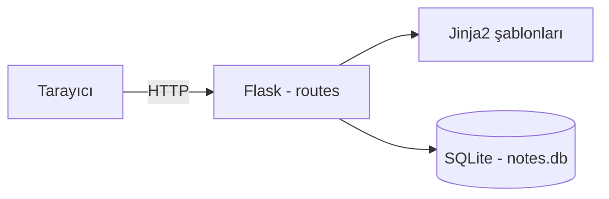

# Mimari ve Veri Modeli

## Genel Mimari

Uygulama, Flask tabanlı klasik bir sunucu taraflı web uygulamasıdır.

| Katman | Teknoloji | Görevi |
|--------|-----------|--------|
| Arayüz | HTML + Jinja2 şablonları (`src/templates/`) | Notların gösterilmesi ve form girişi |
| Uygulama | Flask (`src/app.py`) | İstekleri karşılama, iş mantığı |
| Veri | SQLite | Notların kalıcı saklanması |

## Veri Modeli

**Note**

| Alan | Tür | Açıklama |
|------|-----|----------|
| id | INTEGER, PK, otomatik artan | Not kimliği |
| title | TEXT, zorunlu | Not başlığı |
| content | TEXT | Not içeriği |
| created_at | DATETIME | Oluşturulma zamanı |
| updated_at | DATETIME | Son güncellenme zamanı |

## Planlanan Rotalar

| Yöntem | Yol | Fonksiyon |
|--------|-----|-----------|
| GET | `/` | Notları listele |
| GET/POST | `/notes/new` | Not ekle |
| GET/POST | `/notes/<id>/edit` | Not düzenle |
| POST | `/notes/<id>/delete` | Not sil |
